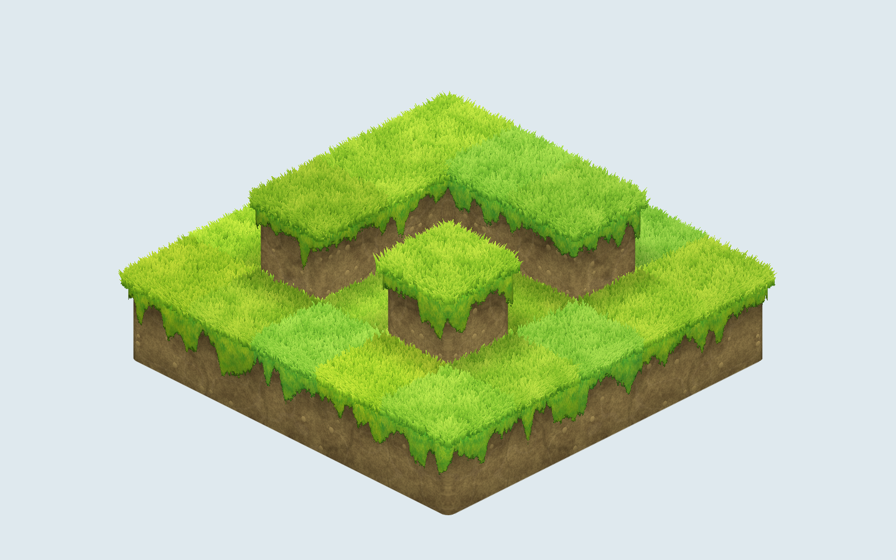

# pkt-grass-blocks

<p align="center">
  
</p>

**English** · [Русский](README.ru.md)

A prototype of a pretty isometric block map in Three.js. The question it answers: can a plain grid of blocks look hand-painted, like the 2D games it takes after, without drawing a tile for every case? Short answer: yes, with a few cheap tricks layered on top of a handful of painted textures.

Everything is procedural except three textures (grass top, grass side, stone). Nothing else is baked.

## Run

```bash
npm install
npm run dev
```

Open the address Vite prints. Drag to rotate, wheel to zoom. The panel at the top left holds every setting; fold it with the button.

```bash
npm run typecheck     # vue-tsc --noEmit
npm run test          # vitest (no tests for the prototype yet)
npm run screenshot    # docs/media/overview.png, needs Chrome or Edge
```

## How it looks the way it does

| Layer | What it does |
| --- | --- |
| **One shared mesh** | The map is a height grid. One surface is built from it with no inner faces, rounded only on exposed edges and with a bevel around inner corners, so block joints and wall seams do not exist. |
| **Grass shell** | A thin skin over the stone, a little wider and higher. Its top is a painted tile, its walls a painted curtain cut off by a noisy, ragged edge. |
| **Blades** | Hundreds of instanced camera-facing cards, their shape drawn in the shader. They stand on the top and lean outward along open edges, which is what gives the top its volume. |
| **Soil** | Procedural: two tones of blotches, grain, cracks, veins and small pebbles, all in world space with triplanar blending so rounded corners have no seams. |
| **Light, cheaply** | A soft shadow under the fringe that follows its shape, a shadow at the foot of tall walls, per-cell tint, and walls that darken as they turn away from the camera. |

Settings are plain sliders in [`src/controls.ts`](src/controls.ts): wind sway, grass seed, tint spread, blade density, soil noise and scale, cracks, veins, pebbles, stone scale, shadows, wall darkening, edge roughness, corner radius and fringe length.

## Ideas worth stealing

The point of the project is less the code than the way we got there: start with something plain and add one cheap trick at a time, looking at the screen after each one. Roughly in the order of how much each one mattered.

**The approach in four lines**
1. **Silhouette before texture.** A flat painted texture on a flat plane looks like a sticker. The scene came alive when the *outline* became irregular and the grass stuck up, not when the textures got better.
2. **Fake light with data, not with lighting.** Shadows are numbers baked into vertices or computed from the same noise that shapes the fringe, so they are cheap and always match the shape.
3. **Everything in world space.** Noise and textures follow the world, not the block, so neighbours continue each other and rotation does not make patterns swim.
4. **A slider for every guess.** Each trick got a slider, and the values were chosen by eye. That is how a vague "a bit more shadow, a bit less noise" turns into defaults in minutes.

**Tricks, from the biggest effect down**
- **Grass blades as cards.** Instanced quads that face the camera around the vertical axis, with the blade shape drawn in the fragment shader (a pointed, curved triangle) and cut out with `discard`. No alpha blending, so nothing to sort. Lean the blades outward along open edges and the silhouette bristles.
- **A fringe cut by noise.** The grass skin is discarded below a ragged length taken from a noise function. Add a second, fine noise to the cut edge so it is not plastic.
- **A shadow that follows the fringe.** Under the fringe, average the fringe length at a few points along the wall. The shadow then repeats the drips but is soft.
- **Shadow at the foot of tall walls.** A per-vertex value (distance to a taller neighbour), with extra grid lines near the wall so the gradient is smooth.
- **One mesh from a height grid.** Build no inner faces and round only exposed edges. This removes seams that no amount of shading hides.
- **Triplanar blending for corners.** When the wall coordinate switches faces on a rounded corner, a seam appears. Blend the projections by the normal's weights instead.
- **Soil as noise layers.** Blotches, grain, then cracks (thin lines of ridged noise), veins and a pebble per grid cell. Small, but this is what turns "brown" into soil.
- **A mask from an existing texture.** The stone texture's luminance has two humps (gaps and stones), so a threshold gives a clean mask. Stones over soil, with a shadow from a shifted copy of the mask and a bright top edge, give relief without a normal map.
- **A tint per cell from a hash, plus a seed.** Cheap variety that makes a flat field read as patches.
- **Walls that darken as they turn from the camera.** It was born from a bug (a transparency experiment that faded walls) and turned out to be a fun stylization. Treat bugs as input.

**Pitfalls we hit**
- GLSL reserves more words than you think: `patch`, `cast`, `half`. Rename the variable.
- `pow(x, y)` with a slightly negative `x` is NaN and quietly skips a `discard` test: clamp it.
- Two coplanar surfaces z-fight. Lower one of them a hair.
- Rounding each cube separately creates seams and holes at big radii. Round on exposed edges only and put a floor under rounded columns.
- Things we tried and dropped: blades hanging along the fringe (artifacts at the roots), transparency-blurred corners (fragile), roots under the grass (looked like scratches).

**How it was made.** Built in conversation with Claude (Claude Code), with a second model through the Cursor agent doing the heavy analysis and generating the painted textures. The workflow for those is in [`docs/textures.md`](docs/textures.md).

## Layout

```
src/
  main.ts       scene, orthographic isometric camera, settings panel
  terrain.ts    puts stone, grass shell and blades together
  skin.ts       builds the mesh from the height grid
  tufts.ts      the instanced blades
  shaders.ts    all shaders
  controls.ts   shared settings
public/tex/     the three painted textures
docs/           notes on the texture workflow
scripts/        screenshot.mjs
архив/          old code, kept only as a source of ideas, not built
```

The map lives in `main.ts` as a small height grid, with an L-shaped second tier and a single pillar to show inner and outer corners.

## Textures

The painted textures are made through the Cursor agent, see [`docs/textures.md`](docs/textures.md) for the workflow and the pitfalls. Stone is optional: set "wall stone coverage" above zero to lay painted stones over the soil like brush strokes that avoid corners.

## Known limits

- Inner corners of walls are still sharp: the top is rounded around them, the vertical join is not.
- The demo uses a fixed light. A time-of-day light would need the camera-dependent wall darkening reconciled with it.
- It is a prototype: no editor, no saving, no tests of the mesh builder yet.
