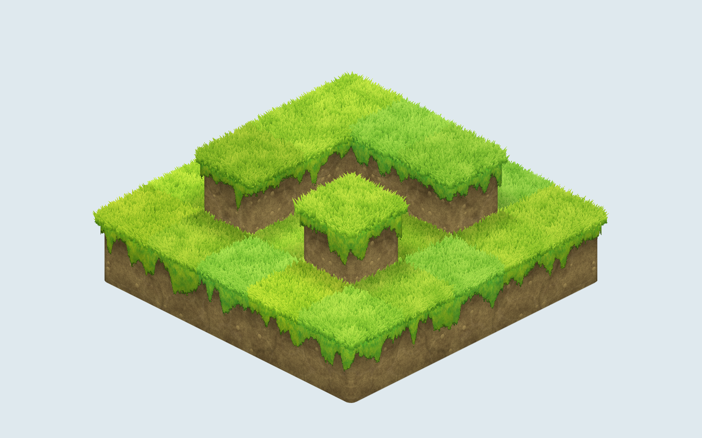

# pkt-block-topo

<p align="center">
  
</p>

[English](README.md) · **Русский**

Прототип красивой изометрической карты из блоков на Three.js. Вопрос, на который он отвечает: может ли обычная сетка блоков выглядеть рисованной, как в 2D-играх, на которые мы равняемся, без отдельного тайла на каждый случай? Короткий ответ: может, если наложить несколько дешёвых приёмов на горсть нарисованных текстур.

Всё процедурное, кроме трёх текстур (верх травы, бок травы, камень). Остального в картинки не запечено.

## Запуск

```bash
npm install
npm run dev
```

Откройте адрес, который напечатает Vite. Тяните мышью для вращения, колесо для масштаба. Панель сверху слева содержит все настройки, её сворачивает кнопка.

```bash
npm run typecheck     # vue-tsc --noEmit
npm run test          # vitest (тестов у прототипа пока нет)
npm run screenshot    # docs/media/overview.png, нужен Chrome или Edge
```

## Почему так выглядит

| Слой | Что делает |
| --- | --- |
| **Один общий меш** | Карта это сетка высот. По ней строится одна поверхность без внутренних граней, скруглённая только на открытых рёбрах и с фаской вокруг внутренних углов. Поэтому стыков блоков и швов на стенах просто нет. |
| **Травяная оболочка** | Тонкая шкурка поверх камня, чуть шире и выше. Верх это нарисованная плитка, стенки нарисованная «занавеска», обрезанная шершавым рваным краем. |
| **Травинки** | Сотни карточек (instancing), всегда повёрнутых к камере, форма рисуется в шейдере. Стоят сверху и клонятся наружу вдоль открытых краёв: именно они дают верху объём. |
| **Земля** | Процедурная: пятна двух оттенков, крупа, трещины, прожилки и мелкие камешки. Всё в мировых координатах с триплоскостным смешиванием, поэтому на скруглённых углах нет швов. |
| **Свет, дёшево** | Мягкая тень под бахромой повторяет её форму, тень у подножия высоких стен, оттенок на клетку и стены, которые темнеют, когда повёрнуты от камеры. |

Настройки это обычные ползунки из [`src/controls.ts`](src/controls.ts): качание ветра, зерно травы, разброс оттенков, густота травинок, шум и масштаб земли, трещины, прожилки, камешки, масштаб камня, тени, затемнение стен, шершавость края, радиус скругления и длина бахромы.

## Структура

```
src/
  main.ts       сцена, ортографическая изометрическая камера, панель настроек
  terrain.ts    собирает вместе камень, травяную оболочку и травинки
  skin.ts       строит меш по сетке высот
  tufts.ts      инстансные травинки
  shaders.ts    все шейдеры
  controls.ts   общие настройки
public/tex/     три нарисованные текстуры
docs/           заметки про работу с текстурами
scripts/        screenshot.mjs
архив/          старый код, только как источник идей, не собирается
```

Карта лежит в `main.ts` маленькой сеткой высот: Г-образный второй ярус и одиночный столб показывают внутренние и внешние углы.

## Текстуры

Нарисованные текстуры заказываются через агента Cursor, процесс и подводные камни описаны в [`docs/textures.md`](docs/textures.md). Камень по умолчанию выключен: поднимите «Покрытие стены камнем» выше нуля, и по земле лягут нарисованные камни, как мазки кисти, обходящие углы.

## Известные ограничения

- Внутренние углы стен пока острые: верх вокруг них скруглён, а вертикальный стык нет.
- В демо фиксированный свет. Для света по времени суток затемнение стен по ракурсу придётся согласовать с ним.
- Это прототип: нет редактора и сохранения, у построения меша пока нет тестов.
